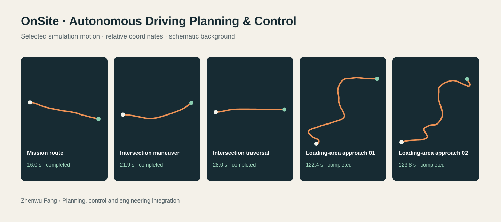

# OnSite · Autonomous Driving Planning & Control

**Zhenwu Fang — Autonomous-driving algorithm development, simulation and engineering integration.**

[Interactive showcase](https://zv-nus.github.io/onsite-driving-showcase/) · [中文说明](README.zh-CN.md) · [GitHub profile](https://github.com/ZV-NUS)

## The engineering problem

How can an autonomous vehicle follow a feasible route, account for surrounding traffic and obstacles, and reach a task destination in different operating environments?

This project brings scene interpretation, short-horizon prediction, route and speed planning, trajectory tracking, and local evaluation into one simulation workflow. Selected examples cover mission routing, intersection traversal, and large-vehicle approaches in loading areas.

## Explore the demonstration

Open the [showcase](https://zv-nus.github.io/onsite-driving-showcase/), choose a scene, and play or scrub through the recorded simulation motion. The replay shows the vehicle trajectory, observed surrounding objects, heading, and speed.

- **Mission routing:** traversable-area routing and destination approach.
- **Intersections:** reference-route tracking with observed surrounding traffic.
- **Loading areas:** obstacle-aware maneuvering and controlled destination approach.

The trajectories and observed objects are derived from existing simulation outputs. Positions are transformed to a scene-relative coordinate system, sampled at approximately 0.5-second intervals, and rounded. Road and site backgrounds are schematic; they are not redistributed competition maps. Missing object observations are not extrapolated.

## Method overview

| Stage | Engineering approach |
| --- | --- |
| Scene interpretation | Read task type, map context, vehicle state, and destination. |
| Prediction | Constant-velocity / constant-acceleration short-horizon motion prediction. |
| Planning | Grid-based A* routing, HD-map reference-route search, and obstacle-aware local planning for loading tasks. |
| Tracking | Pure-pursuit lateral tracking and longitudinal speed-profile tracking. |
| Interaction | Conservative deceleration using distance, lateral overlap, and time to collision. |
| Evaluation | Inspect completion, elapsed time, motion stability, and interaction-risk indicators. |

## Selected recorded runs

| Scenario | Local simulation time | Recorded end status |
| --- | ---: | --- |
| Mission route | 16.0 s | Completed (`4`) |
| Intersection maneuver | 21.9 s | Completed (`4`) |
| Intersection traversal | 28.0 s | Completed (`4`) |
| Loading-area approach 01 | 122.4 s | Completed (`4`) |
| Loading-area approach 02 | 123.8 s | Completed (`4`) |

These are five selected completed local runs. They do not establish an overall competition success rate, an official score or ranking, or real-road performance. Completion records reaching the simulator's task termination condition; it is not a claim of zero risk or perfect parking. The times come from the selected output records, rather than an older prose summary.

## What is shared

This repository contains the portfolio page, its frontend renderer, selected derived replay traces, and the overview documentation. **The full planning/control implementation, original CSV outputs, competition maps, and complete experiment records remain private.** This is a standalone showcase repository with its own history, not a public mirror or fork of the research repositories.

See [PROVENANCE.json](PROVENANCE.json) for the scope and transformations of the published replay data. To view locally, serve this directory with any static HTTP server; no model, credentials, backend, or private research dependency is required.

## Related project

[Human–LLM Co-Pilot](https://github.com/ZV-NUS/human-llm-copilot) explores language-guided human–machine shared decision-making. OnSite is a separate planning-and-control engineering project; the showcase does not attribute LLM or reinforcement-learning components to this implementation.
