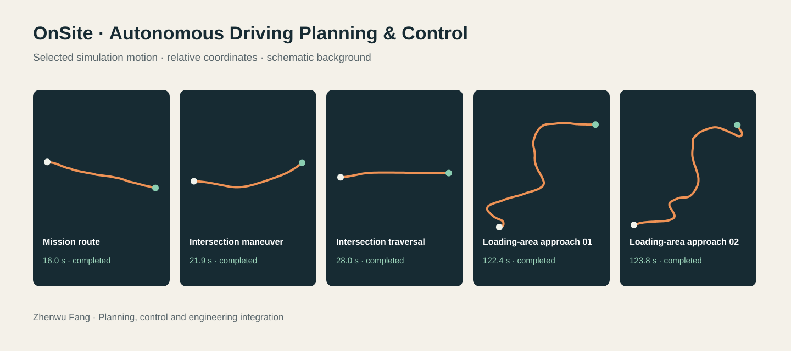

# OnSite 自动驾驶规划与控制

**方振伍｜自动驾驶算法开发、仿真验证与工程集成**

[打开交互展示](https://zv-nus.github.io/onsite-driving-showcase/?lang=zh) · [English](README.md) · [GitHub 个人主页](https://github.com/ZV-NUS)

## 项目内容

围绕自动驾驶车辆在不同任务环境中的路径规划、车速协调和轨迹跟踪，搭建场景解析、短时预测、规划、控制及本地评估的完整仿真流程。展示任务包括任务路径、交叉路口通行和大型车辆装载区驶入。

## 技术流程

- **场景解析：** 结合任务类型、地图信息、车辆状态和目标区域组织规划流程。
- **短时预测：** 基于常速度／常加速度模型预测周围车辆运动。
- **路径与速度规划：** 栅格 A* 搜索、高精地图参考路径搜索及装载区障碍感知局部规划。
- **轨迹跟踪：** 纯追踪横向控制与速度曲线跟踪。
- **交互处理：** 根据距离、横向重叠和碰撞时间实施保守减速。
- **结果评估：** 检查任务完成、用时、运动稳定性和交互风险。

## 精选仿真记录

| 场景 | 仿真用时 | 记录状态 |
| --- | ---: | --- |
| 任务路径规划 | 16.0 秒 | 完成，`end=4` |
| 交叉路口通行 | 21.9 秒 | 完成，`end=4` |
| 交叉路口穿行 | 28.0 秒 | 完成，`end=4` |
| 装载区驶入 01 | 122.4 秒 | 完成，`end=4` |
| 装载区驶入 02 | 123.8 秒 | 完成，`end=4` |

上表对应五个精选的本地已完成运行，不代表全部场景通过率、官方比赛成绩或实车道路验证。完成状态表示满足该仿真器的任务终止条件，不表示零风险或精确停车。用时以所选输出记录为准，没有沿用较早说明文档中的另一组时间。

## 如何观看

打开交互页面后，选择场景，使用播放、进度条和倍速控件查看车辆及环境对象的运动。公开轨迹由已有仿真输出抽样生成，按场景平移、旋转坐标并取整，不保留原始全局位置。周围对象来自同次运行的已记录观测；道路与场地背景采用示意绘制，没有公开比赛地图。

## 公开范围

公开内容仅包括项目介绍、网页展示程序及精选派生回放。**完整规划控制算法、原始 CSV、比赛地图与完整实验记录继续保留私有。** 本仓库独立建立，不复制研究仓库的历史。

数据处理及展示边界见 [PROVENANCE.json](PROVENANCE.json)。该展示可独立运行，无需模型、密钥或私有研究环境。

另一个研究项目：[Human–LLM Co-Pilot 人机共享决策](https://github.com/ZV-NUS/human-llm-copilot)。两个项目分别展示大模型共享决策与自动驾驶规划控制，本项目没有把未实现的大模型或强化学习模块写入技术能力。
